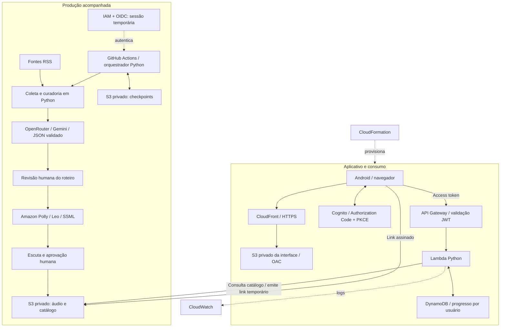
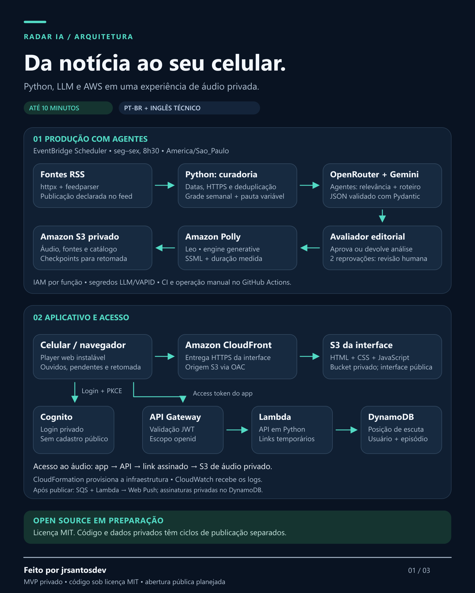

# Radar IA

**Do excesso de notícias a uma experiência de áudio que cabe na rotina.**

[](pyproject.toml)
[](infra/private-app.json)
[](LICENSE)
[](https://github.com/jjsjunior3/radar-ia/actions/workflows/tests.yml)

Radar IA transforma notícias de inteligência artificial e do mercado de tecnologia em episódios de **até 10 minutos**, narrados em português brasileiro, com **inglês técnico explicado no contexto**. Um aplicativo web com login permite ouvir no Android e no computador, acompanhar o que já foi ouvido e retomar a reprodução.

Desenvolvido por **[jrsantosdev](https://github.com/jjsjunior3)** como projeto de portfólio e aprendizado aplicado em Python, IA generativa e AWS.

[Visão do produto](docs/01-produto.md) · [Arquitetura](#arquitetura) · [Executar localmente](#executar-localmente) · [Produção e agendamento](docs/07-producao-acompanhada.md) · [Artes para divulgação](docs/08-comunicacao-e-arquitetura.md)

> **Estado do projeto:** MVP privado em uso. Código sob licença MIT, com abertura pública do repositório planejada. Aplicativo e áudio validados pelo proprietário no computador e Android. O acesso AWS pelo GitHub Actions foi validado; o agendamento está habilitado e a primeira produção agendada de uma edição nova ainda aguarda validação. Roteiro e áudio passam por revisão humana antes da publicação.

## O problema

Acompanhar IA exige filtrar anúncios, lançamentos, ferramentas e notícias de mercado de várias fontes. Ler tudo consome tempo; ouvir um resumo ajuda, desde que ele preserve referências, evite repetições e explique os termos técnicos.

O Radar IA reúne coleta, curadoria por regras, roteiro com LLM e síntese de voz em um fluxo rastreável. O limite de duração é um teto: dias com pouco conteúdo podem gerar uma edição curta ou nenhuma edição.

## O que o MVP entrega

- **Coleta RSS:** fontes configuráveis, datas declaradas de publicação, URLs HTTPS e domínios permitidos.
- **Curadoria editorial:** deduplicação por URL/título semelhante, grade semanal e seleção variável de uma a sete notícias.
- **Roteiro em português:** geração estruturada via OpenRouter, validação com Pydantic, glossário e termos em inglês contextualizados.
- **Áudio:** Amazon Polly, voz Leo generativa, marcação SSML para pausas/idioma e duração WAV medida antes da publicação.
- **Biblioteca privada:** player web instalável no Android, filtros de ouvidos/pendentes e progresso por usuário.
- **Revisão pelo app:** responsável acompanha a edição, lê roteiro/fontes e aprova a versão exibida, sem disparar voz ou publicação.
- **Operação acompanhada:** checkpoints privados no S3, retomada de resultados salvos e aprovações vinculadas ao conteúdo revisado.
- **Infraestrutura reproduzível:** template CloudFormation e acesso temporário do GitHub à AWS via OIDC.

## Arquitetura



O S3 da interface e o S3 de áudio têm funções diferentes. CloudFront entrega a interface por HTTPS a partir de uma origem privada. Catálogo, progresso e links de reprodução exigem autenticação; o áudio usa URLs temporárias emitidas pela API.

**Componentes de IA:** a LLM gera o roteiro. Coleta, curadoria, validação, publicação e retomada são módulos Python; o Polly realiza síntese de voz. A versão atual usa orquestração explícita e revisão humana. Um sistema de agentes autônomos é uma possibilidade de evolução, não uma funcionalidade implementada.

<details>
<summary>Ver o mapa completo da arquitetura</summary>



[Versão SVG editável](docs/assets/linkedin/01-arquitetura.svg)

</details>

## Tecnologias e responsabilidades

| Camada | Tecnologias | Responsabilidade |
|---|---|---|
| Coleta | Python, httpx, feedparser | Ler feeds e verificar páginas sob domínios permitidos |
| Curadoria | Python, grade editorial e heurísticas | Selecionar candidatas, deduplicar e organizar pauta |
| Geração de texto | OpenRouter, Gemini 2.5 Flash, Pydantic | Produzir e validar o roteiro estruturado |
| Síntese de voz | Amazon Polly, Leo generativa, SSML | Narrar em português e contextualizar termos em inglês |
| Armazenamento | Amazon S3 | Guardar áudio, fontes, catálogo e checkpoints privados |
| Interface | HTML, CSS, JavaScript, CloudFront, S3 + OAC | Entregar o player web por HTTPS |
| Autenticação | Amazon Cognito, OAuth 2.0 + PKCE | Autenticar sem segredo de cliente no navegador |
| API | API Gateway, AWS Lambda, Python | Consultar episódios, emitir links e registrar progresso |
| Progresso | Amazon DynamoDB | Sincronizar posição e marcação por usuário/episódio |
| Infraestrutura e logs | CloudFormation, IAM, CloudWatch | Provisionar recursos, separar permissões e registrar eventos |
| Execução e qualidade | GitHub Actions, OIDC, pytest, Node.js | Agendar, usar sessões temporárias e executar testes |

## Uma edição, do início ao play

1. A rotina inicia a coleta e prepara a pauta da data local em São Paulo.
2. O programa valida candidatas e a LLM produz o roteiro com referências.
3. Uma pessoa revisa o texto e registra a aprovação do conteúdo exato.
4. Polly sintetiza os trechos; o programa combina o áudio e mede sua duração.
5. Uma pessoa ouve o resultado e aprova a publicação.
6. O episódio entra no catálogo privado. Somente depois da confirmação, o histórico editorial avança.
7. O aplicativo permite ouvir, marcar e retomar, com progresso sincronizado.

**Agendamento:** segunda a sexta, às **8h30 em `America/Sao_Paulo`**. A rotina agendada prepara o roteiro e aguarda revisão. Voz e publicação continuam manuais. O GitHub pode atrasar eventos; o horário indica início previsto da produção.

### Grade editorial

| Dia | Tema |
|---|---|
| Segunda | Panorama da semana e acontecimentos do fim de semana |
| Terça | Carreira e mercado de tecnologia |
| Quarta | Ferramentas e aplicações |
| Quinta | Engenharia de IA |
| Sexta | Fechamento da semana |

A seleção depende de conteúdo elegível. Retomadas não são publicadas automaticamente como se fossem notícias novas.

## Executar localmente

### Pré-requisitos

- Python **3.12** é o ambiente validado do projeto; o pacote declara Python 3.11 ou superior.
- Para usar AWS: conta, permissões adequadas e AWS CLI com sessão local válida.
- Para gerar roteiro: chave OpenRouter configurada localmente.
- GitHub CLI para configurar o repositório e disparar o workflow pelo terminal.

No Windows, a partir da raiz:

```bat
py -3.12 -m venv .venv
.\.venv\Scripts\python.exe -m pip install -e ".[test]"
```

Na primeira configuração, copie `.env.example` para `.env` e preencha suas variáveis. Preserve um `.env` existente. O arquivo real é ignorado pelo Git; variáveis já definidas no terminal têm precedência.

### Explorar sem gerar conteúdo pago

```bat
.\.venv\Scripts\radar-ia.exe --help
.\.venv\Scripts\radar-ia.exe --preview
.\.venv\Scripts\python.exe -m radar_ia.local_app --demo
```

`--preview` acessa as fontes RSS e salva a coleta local sem LLM ou AWS. A biblioteca em `--demo` abre em `http://127.0.0.1:8765`, usa dados de demonstração e não acessa AWS. O modo local não é a API hospedada de produção.

### Produção acompanhada

```bat
.\.venv\Scripts\radar-ia.exe production --help
.\.venv\Scripts\radar-ia.exe production prepare
.\.venv\Scripts\radar-ia.exe production status
```

Os comandos de produção usam o estado privado no S3 e precisam da configuração AWS. `status` baixa uma cópia dos arquivos para consulta. A cópia baixada não é importada automaticamente como edição de roteiro.

As etapas seguintes são explícitas e devem ser usadas após a revisão correspondente:

```bat
.\.venv\Scripts\radar-ia.exe production draft --execute
.\.venv\Scripts\radar-ia.exe production approve-script --reviewed
.\.venv\Scripts\radar-ia.exe production audio --execute
.\.venv\Scripts\radar-ia.exe production approve-audio --reviewed
.\.venv\Scripts\radar-ia.exe production publish --execute
```

`draft` e `audio` podem gerar custo. Execute cada etapa separadamente, revise os resultados e mantenha as aprovações ligadas ao conteúdo que você verificou. Veja o [guia operacional completo](docs/07-producao-acompanhada.md) para datas, checkpoints, IAM, segredos e Actions.

## Confiabilidade, privacidade e limites

- Buckets privados, bloqueio de acesso público, ACLs desativadas e criptografia S3 configurada.
- Cadastro público do app desativado; tokens de acesso em memória e autorização na API.
- Progresso separado pelo identificador autenticado do usuário, com atualização condicional.
- Gravações condicionais com ETag evitam sobrescrever catálogo/estado lidos em versão antiga.
- Resultado pago incerto bloqueia repetição automática; isso reduz duplicações, mas não garante cobrança única pelo provedor.
- Aprovações e hashes detectam alteração do roteiro/áudio depois da revisão.
- Credenciais, episódios, progresso e saídas locais não são publicados com o código.

A data declarada no RSS e o acesso ao link **não comprovam os fatos da notícia**. Heurísticas de título podem perder duplicatas ou rejeitar assuntos semelhantes. A LLM recebe resumos, não necessariamente o artigo integral. Esses limites tornam a revisão editorial parte do produto.

O MVP depende de conexão; não há reprodução offline implementada. A versão hospedada e o protótipo local têm mecanismos distintos de autenticação e armazenamento de progresso.

## Qualidade e validação

```bat
.\.venv\Scripts\python.exe -m pytest -q
node --test tests/web/auth.test.cjs
node --check src/radar_ia/web/app.js
node --check src/radar_ia/web/auth.js
```

Os testes cobrem regras de coleta, curadoria, roteiro, áudio, catálogo, progresso, autenticação e recuperação, usando serviços simulados. Um teste do fluxo completo restaura o estado em um ambiente novo entre etapas e verifica que repetir a publicação não duplica o mesmo episódio.

O [workflow de testes](.github/workflows/tests.yml) não exige chaves de provedores. Testes locais e simulados não substituem a validação de IAM, quotas, custos ou uma edição real no Actions.

**Validação operacional registrada:** login, reprodução e progresso no computador/Android confirmados pelo proprietário; episódio de 29/10/2026 produzido pelo fluxo acompanhado e publicado com Leo após aprovação do roteiro e áudio. O evento agendado desse dia foi registrado às 14h29 de São Paulo, em vez das 8h30 previstas, e reaproveitou o roteiro já existente. Uma edição nova preparada pelo agendamento desde o início ainda precisa ser validada; sucesso do workflow não comprova pontualidade nem publicação automática.

## Estrutura do repositório

```text
.github/workflows/    Testes e produção acompanhada
config/              Fontes RSS e exemplos de permissões
src/radar_ia/        Coleta, curadoria, roteiro, áudio, catálogo e APIs
src/radar_ia/web/    Interface do aplicativo
infra/               Template CloudFormation
examples/            Comandos de aprendizado, provisionamento e operação
tests/               Testes Python e JavaScript
docs/                Decisões, setup e guias de operação
docs/assets/         Imagens PNG e SVG editáveis para divulgação
tools/               Gerador dos diagramas
local-output/        Arquivos privados gerados; ignorados pelo Git
```

## Documentação

| Guia | Conteúdo |
|---|---|
| [01 · Produto](docs/01-produto.md) | Escopo e decisões editoriais |
| [02 · OpenRouter](docs/02-openrouter.md) | Configuração, geração e validação do roteiro |
| [03 · Primeiro áudio](docs/03-primeiro-audio.md) | Voz, SSML e teste de escuta |
| [04 · S3 privado](docs/04-s3-privado.md) | Bucket, catálogo e publicação |
| [05 · Biblioteca local](docs/05-biblioteca-local.md) | Protótipo, player e progresso local |
| [06 · App hospedado](docs/06-app-hospedado.md) | Arquitetura AWS, implantação e operação |
| [07 · Produção acompanhada](docs/07-producao-acompanhada.md) | Checkpoints, IAM/OIDC e GitHub Actions |
| [08 · Comunicação e arquitetura](docs/08-comunicacao-e-arquitetura.md) | Três modelos de imagem e orientações de divulgação |
| [09 · Revisão no aplicativo](docs/09-revisao-no-app.md) | Estado da edição, fontes e aprovação de roteiro pelo responsável |

## Custos

O roteiro é cobrado pelo provedor usado via OpenRouter; a voz pelo Amazon Polly. S3, CloudFront, API Gateway, Lambda, DynamoDB, Cognito, CloudWatch e recursos de backup podem gerar cobranças conforme uso e configuração. GitHub Actions também está sujeito às condições e limites do plano.

Checkpoints reduzem retrabalho, mas armazenam rascunhos e transferem dados. Não há promessa de custo zero. Os guias de [áudio](docs/03-primeiro-audio.md), [S3](docs/04-s3-privado.md) e [app hospedado](docs/06-app-hospedado.md) detalham as decisões operacionais. Valores e franquias devem ser consultados antes de ampliar o uso.

## Evolução planejada

- [x] RSS, grade editorial e roteiro estruturado.
- [x] Polly, catálogo privado e aplicativo validado no Android.
- [x] Checkpoints privados e autenticação AWS via OIDC no Actions.
- [x] Agendamento configurado e habilitado.
- [ ] Validar a primeira edição nova pelo fluxo agendado completo.
- [x] Mostrar a edição e permitir aprovação do roteiro pelo responsável no aplicativo.
- [ ] Permitir edição/rejeição de rascunhos e revisão/publicação do áudio pela interface.
- [ ] Melhorar observabilidade, retenção de rascunhos e acompanhamento de custos.
- [ ] Revisar o repositório e disponibilizar o código publicamente.
- [ ] Criar um feed RSS público como canal opcional de distribuição.

O feed público exigirá uma decisão própria de distribuição e acesso aos arquivos; URLs S3 temporárias do app não funcionam como endereço permanente de podcast.

## Licença e participação

O código é distribuído sob a [licença MIT](LICENSE). O repositório está privado durante esta fase de revisão e preparação para abertura pública. A licença do código não transfere direitos sobre notícias de terceiros, dados pessoais ou credenciais.

Ao abrir o repositório, contribuições poderão focar melhorias reproduzíveis, correções de bugs e documentação. Issues e pull requests devem usar dados fictícios e preservar informações de conta. Alterações de privacidade, custos e publicação precisam explicar seu impacto.

**Feito por jrsantosdev.**
