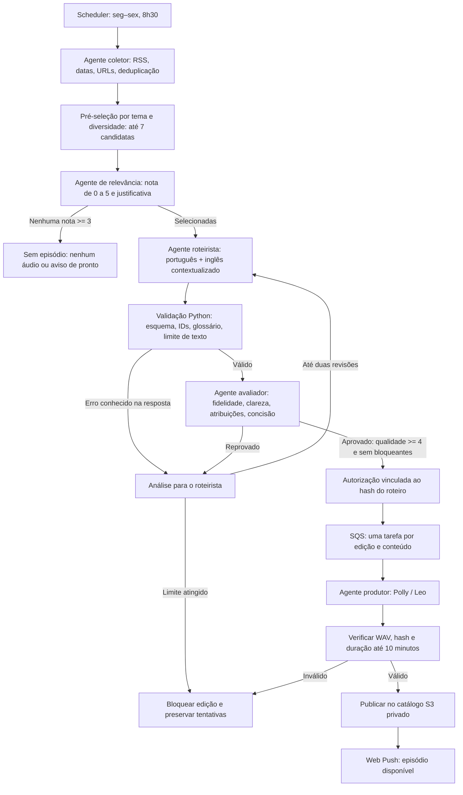

# 16 · Agentes editoriais e ciclo de revisão

O Radar IA usa agentes especializados coordenados em Python. Os agentes de relevância, roteiro e avaliação fazem chamadas LLM separadas, com prompts e saídas estruturadas próprios. Coleta e produção são agentes determinísticos: não precisam de uma LLM para ler RSS ou chamar o Polly. Eles não são processos autônomos soltos nem dependem de um framework de agentes.

## Responsabilidades

| Agente | Implementação | Entrada e saída |
|---|---|---|
| Coletor | `CollectionAgent` + módulos de RSS e planejamento | Feeds → notícias elegíveis e pauta preliminar |
| Relevância | `RelevanceAgent` | Até 7 candidatas da pré-seleção → nota e motivo por ID; mantém notas a partir de 3 |
| Roteirista | `ScriptWriterAgent` | Evidências selecionadas + análise anterior → roteiro estruturado |
| Avaliador | `ScriptReviewerAgent` | Roteiro + resumos originais → aprovação, nota e correções por notícia |
| Produtor/publicador | `worker.py` + `Production` | Roteiro com aprovação válida → áudio verificado, catálogo e aviso |

A seleção LLM atua nas candidatas já filtradas pelo planejamento existente, não em toda a internet ou em todas as entradas RSS. O modelo não pode inventar IDs, incluir notícias externas ou aprovar um roteiro com problemas bloqueantes. O avaliador recebe as evidências originais e é instruído a não tratar publicidade como comprovação independente. Mesmo assim, avaliação por LLM não equivale a checagem factual externa.

## Reprovação e custos

São permitidas três versões de roteiro: uma inicial e até duas correções. Cada versão válida recebe uma avaliação separada. No pior caso normal são sete chamadas LLM: uma de relevância, três de roteiro e três de avaliação. A coleta não usa tokens. O limite de tempo compartilhado pode encerrar a edição antes de consumir todas as tentativas.

Uma resposta estruturalmente inválida recebida pode orientar a próxima correção. Uma chamada sem resposta salva é incerta: o sistema para, não tenta cobrar de novo. Reprovação persistente bloqueia o Polly. Não há garantia de geração de episódio todos os dias nem de qualidade perfeita do avaliador.

## Rastreamento

O checkpoint privado de cada edição contém:

- `agents/original-brief.json`: candidatas originais antes da seleção LLM.
- `agents/relevance-decision.json`: notas e justificativas.
- `agents/relevance/`, `agents/writer-N/`, `agents/reviewer-N/`: marcador anterior à chamada e resposta original, incluindo uso informado pelo provedor.
- `agents/review-N.json`: parecer estruturado do avaliador.
- `agents/approval.json`: versão da política, número da versão aprovada, qualidade e hash do conteúdo aprovado.
- Autorizações do roteiro e do áudio com `mode=automatic`, distintas de aprovação humana.

Esses arquivos ficam no S3 privado e podem ser baixados pelo diagnóstico/status de produção; não devem ser enviados ao GitHub. Alterar o roteiro invalida a aprovação editorial. O worker confere essa vinculação antes de chamar o Polly.

## Testes e implantação

`tests/test_agents.py` usa respostas simuladas para verificar reprovação → análise → correção → aprovação; esgotamento de três versões; ausência de notícias relevantes; referências inválidas; aprovação contraditória; cache de respostas e resultado pago incerto. Os testes de produção verificam publicação antes da notificação e desativação do modo automático.

O helper `examples/configurar_automacao.py --plan --enable` empacota a versão com agentes e prepara a atualização, sem executar o change set. O processo de ativação/pausa está no [guia de operação](15-publicacao-automatica.md). O modo automático precisa ser validado em uma edição diária real após a implantação; testes simulados não comprovam esse ciclo externo.
