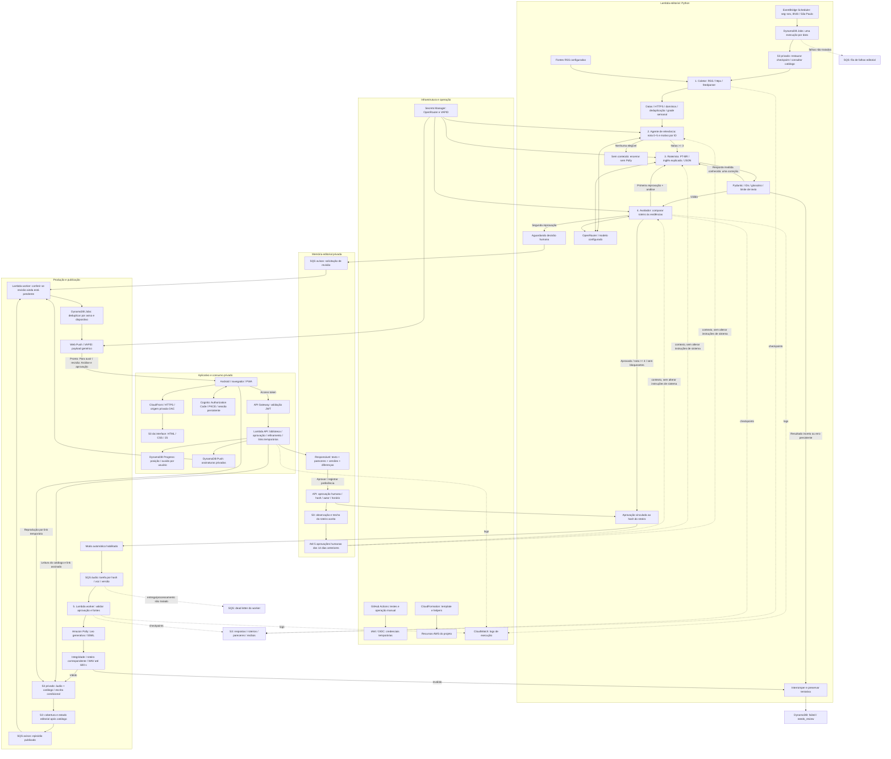

# 18 · Organograma completo: agentes, serviços e aprendizado

O diagrama descreve a implementação, incluindo caminhos de reprovação, decisão humana e memória editorial. Os agentes LLM têm papéis separados e são coordenados por Python; não executam livremente código ou alterações de infraestrutura.

## Como cada agente trabalha

| Papel | Recebe | Decide ou produz | Limite |
|---|---|---|---|
| Coletor | RSS, domínios permitidos e janela editorial | Evidências e candidatas deduplicadas | Não usa LLM; não lê a internet sem restrição |
| Relevância | Até 7 candidatas pré-selecionadas + preferências humanas | Nota e justificativa; mantém notas a partir de 3 | Não pode inventar IDs ou incluir fontes externas |
| Roteirista | Evidências selecionadas, memória e parecer anterior | Roteiro, títulos/resumos PT-BR e inglês contextualizado | Até duas versões; máximo inicial de mil palavras |
| Avaliador | Roteiro, evidências e memória | Aprovação ou correções por notícia; nota 0–5 | Aprova com nota >= 4 e sem bloqueantes; não é checagem factual externa |
| Produtor | Aprovação ligada ao conteúdo e tarefa idempotente | Áudio Polly, verificação, publicação e aviso | Sem resposta paga salva, não repete automaticamente; áudio até dez minutos |
| Responsável humano | Segundo roteiro reprovado, pareceres e mudanças | Aprovação final e preferências futuras | A decisão não remove verificações técnicas nem modifica o roteiro silenciosamente |

## Como ele “aprende”

1. Uma aprovação humana pelo app registra observação opcional, trecho aceito, hash, autor e horário.
2. Um registro pequeno e privado é salvo no S3 por data; repetição da mesma aprovação não duplica o evento.
3. Na próxima edição, o sistema carrega até cinco aprovações dos 14 dias anteriores, pertencentes ao responsável configurado.
4. Relevância, roteirista e avaliador recebem esse contexto como preferências editoriais. Fontes e instruções de sistema continuam prevalecendo.
5. O painel mostra o contexto efetivamente usado naquela edição, as versões preservadas e uma comparação textual.

Esse mecanismo é memória contextual. Não altera pesos do modelo, não faz fine-tuning, não reescreve código e não comprova que toda edição ficou melhor. Aprovações automáticas não alimentam a memória. A janela de consulta não apaga os registros S3; o administrador pode remover preferências no armazenamento privado.

## Catálogo de serviços

| Serviço | Função |
|---|---|
| EventBridge Scheduler | Iniciar rotina em fuso São Paulo, sem computador ligado |
| Lambda editorial | Coordenar coleta e agentes, guardar checkpoints e enfileirar produção/revisão |
| OpenRouter / Gemini configurado | Chamadas LLM separadas para relevância, roteiro e avaliação |
| SQS áudio / avisos / filas de falha | Desacoplar trabalho e encaminhar falhas não tratadas |
| Lambda worker | Gerar áudio, publicar e entregar avisos com deduplicação |
| Amazon Polly | Síntese Leo generativa com SSML |
| S3 de áudio | Catálogo, episódios, checkpoints, memória e artefatos de implantação privados |
| DynamoDB Jobs | Reivindicação de tarefas, status e ledger de avisos |
| CloudFront + S3 web + OAC | Entregar a interface por HTTPS com origem privada |
| Cognito | Login sem cadastro público; OAuth/PKCE |
| API Gateway + Lambda API | Validar acesso e operar biblioteca, progresso, revisão e links assinados |
| DynamoDB Progress / Push | Posição de escuta e assinaturas por responsável/dispositivo |
| Secrets Manager | Segredos OpenRouter e VAPID fora do repositório |
| IAM / OIDC | Permissões por função e acesso temporário do GitHub |
| CloudWatch | Logs de execução, sem registrar chaves ou payloads privados de push |
| CloudFormation | Recursos declarados em arquivo versionado |
| GitHub Actions | Testes e operação manual; seu cron de produção fica bloqueado quando o Scheduler AWS está ativo |

Os logs não constituem, por si só, um painel de métricas de qualidade/custo. Avaliação mensurável de roteiros e observabilidade mais completa são evoluções propostas.
